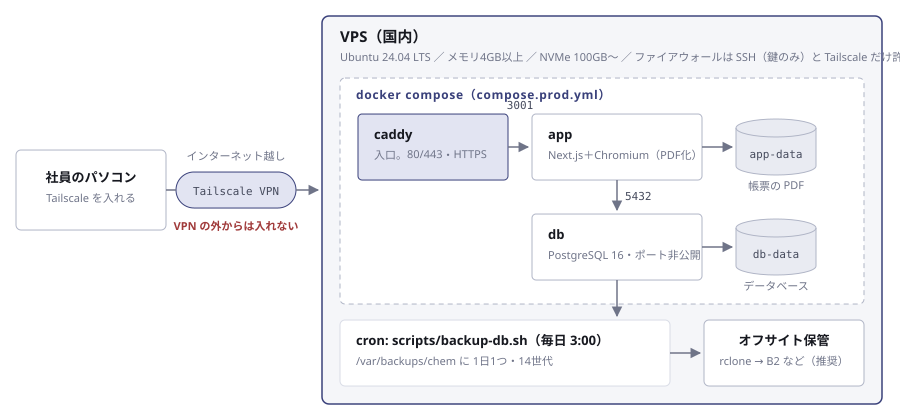
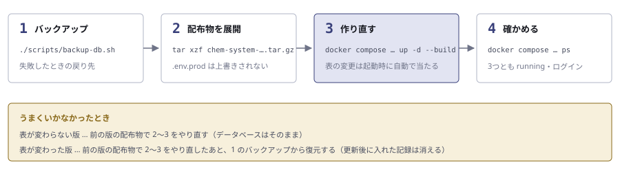

# 化学物質管理システム 運用構成書（本番環境）

| 版 | 1.2（2026-10-16） |
|---|---|
| 目的 | 本番環境の標準構成・構築手順・運用手順（更新/バックアップ/復元）・セキュリティ対策を定義する |
| 対象 | **社内向け。**こちらが国内VPSでアプリを動かし、お客さまに使ってもらう場合の Docker Compose 運用 |
| 関連 | 社内サーバー導入要件・社内サーバー導入手順書（お客さま向け。社内LANのサーバーに置く場合。Windows Server 版を含む） |

> **お客さまには渡しません。**お客さまが社内LANに置く場合は「社内サーバー導入要件」（導入前の確認用）と「社内サーバー導入手順書」（作業の手順）をお渡しします。
> いま動かしている公開の検証環境は Railway で、本書の VPS 構成ではありません（VPS で動かすことになったときの設計として残している）。
>
> この文書は**サーバーの構成と運用**だけを扱います。画面の使い方はアプリ内の「ユーザーマニュアル」（`/spec`）、
> 確定した仕様は `docs/steps/`、設計判断は `docs/decisions/` にあります。
> お客さまの社内サーバーへ入れる手順は「社内サーバー導入手順書」が正です（本書と同じ Docker 構成のほか、Windows Server 版もあります）。

---

# 1. 標準構成

## 1.1 構成図



外向きの通信は、OS の更新とバックアップの転送だけ。

## 1.2 コスト目安（2026年時点の一般的な水準）
| 項目 | 月額 |
|---|---|
| VPS（4GB/NVMe 100GB級） | 約800〜2,000円 |
| Tailscale（VPN） | 無料（小規模枠） |
| オフサイトバックアップ（B2等・〜50GB） | 数十〜数百円 |
| **合計** | **約1,000〜2,500円** |

認証は自前で持つため、認証用の外部サービスの費用はかかりません（2026-07-30 に Supabase をやめた）。

## 1.3 ファイル構成（リポジトリ側）
| ファイル | 役割 |
|---|---|
| `Dockerfile` | アプリ本番イメージ（Node 24 ＋ 帳票の PDF 化に使う Chromium ＋ 日本語フォント。起動時に `prisma migrate deploy` を自動実行） |
| `compose.prod.yml` | 本番サービス定義（caddy/app/db。db・appはポート非公開。保存領域は db-data と app-data） |
| `deploy/Caddyfile` | HTTPS設定（既定=VPN内・社内LAN運用の内部CA。開かれた名前ごとに証明書を作る。公開ドメイン用の記載例は末尾） |
| `.env.prod.example` | 本番環境変数のテンプレート（`.env.prod` にコピーして使用・コミット禁止） |
| `scripts/backup-db.sh` | 日次バックアップ（cron用・復元例をコメント記載） |
| `scripts/package-release.sh` | 配布物（`chem-system-<版>.tar.gz`）と、`--images` でオフライン用の Docker イメージ（`chem-images-<版>.tar`）を作る |
| `scripts/build-install-set.ps1` / `deploy/windows/` | Windows Server 版のインストールセットと、導入・更新・確認のスクリプト（社内サーバー導入手順書 10） |

---

# 2. 初回セットアップ手順（VPS）

```bash
# 1) OS初期設定（Ubuntuの例）
sudo apt update && sudo apt -y upgrade
sudo apt -y install unattended-upgrades          # セキュリティ自動更新
# SSH: 鍵認証のみ・パスワード認証無効化（/etc/ssh/sshd_config → PasswordAuthentication no）

# 2) Docker
curl -fsSL https://get.docker.com | sh
sudo usermod -aG docker $USER   # 再ログイン

# 3) Tailscale（VPN）
curl -fsSL https://tailscale.com/install.sh | sh
sudo tailscale up               # 表示URLで自社アカウントに紐づけ

# 4) ファイアウォール（Tailscale外から80/443を閉じる）
sudo ufw allow in on tailscale0
sudo ufw allow 22/tcp
sudo ufw enable

# 5) アプリ配置（配布物は scripts/package-release.sh で作る。git clone でもよい）
sudo mkdir -p /opt/chem && sudo chown $USER /opt/chem
tar xzf chem-system-<版>.tar.gz -C /opt/chem && cd /opt/chem
cp .env.prod.example .env.prod
vi .env.prod                    # DB_PASSWORD を必ず強力な値に（openssl rand -hex 24。英数字だけにする）

# 6) 起動（マイグレーションは起動時に自動適用）
docker compose -f compose.prod.yml --env-file .env.prod up -d --build

# 7) 管理者アカウントの作成とパスワード発行（自前認証。最初の1人だけ CLI、以降は管理画面）
#    全権限が付く。パスワードは12文字以上
docker compose -f compose.prod.yml --env-file .env.prod exec app   npx tsx scripts/set-password.ts admin@example.com 'ここに強いパスワード' --create

# 7a) 法規制データの投入（この構成書の範囲外。docs/法規制データの作り方.md の手順で、こちらが投入する）

# 8) バックアップcron登録（置き場所と記録のファイルは先に作っておく）
sudo install -d -o $USER /var/backups/chem
sudo install -o $USER /dev/null /var/log/chem-backup.log
chmod +x scripts/backup-db.sh
crontab -e   # → 0 3 * * * /opt/chem/scripts/backup-db.sh >> /var/log/chem-backup.log 2>&1
```

動作確認: 社員PCでTailscaleに接続し `https://<VPSのTailscale名またはIP>/` を開く→ログイン。
（内部CA証明書の警告を消すには deploy/Caddyfile 冒頭のコメント記載の手順でルート証明書を配布。
パスキーを使うなら、名前で開き、証明書の警告が出ない状態にする）

# 3. 更新手順（アプリのバージョンアップ）



```bash
cd /opt/chem
./scripts/backup-db.sh                                                    # 先にバックアップ
tar xzf ~/chem-system-<新しい版>.tar.gz                                    # git clone した場合は git pull
docker compose -f compose.prod.yml --env-file .env.prod up -d --build   # 1〜3分
# 問題があれば前の版の配布物で同じことをする。表が変わった版から戻すときは、更新前のバックアップから復元する
```

- データベースの中身（db-data）と作った帳票の PDF（app-data）は、入れ物を作り直しても残る
- `.env.prod` を直したときも `up -d` で作り直す（`restart` では新しい値が効かない）

# 4. バックアップ／復元

- **取得**: cronで毎日 `scripts/backup-db.sh`（pg_dump→gzip、既定14世代保持、`BACKUP_DIR`=/var/backups/chem）
- **オフサイト**: スクリプト末尾のrclone行を有効化し、B2/R2等へ毎日コピー（強く推奨）
- **帳票の PDF はこのバックアップに入らない**（DB には置き場所だけを持つ）。残すなら
  `docker volume inspect chem_app-data` の `Mountpoint` も複製の対象にする
- **復元**:
```bash
docker compose -f compose.prod.yml --env-file .env.prod stop app
gunzip -c /var/backups/chem/chem_YYYYMMDD_HHMMSS.sql.gz | \
  docker compose -f compose.prod.yml --env-file .env.prod exec -T db psql -U chem chem
docker compose -f compose.prod.yml --env-file .env.prod start app
```
- サーバー全損時: 新VPSで§2の手順→最後に上記復元（所要目安30分〜1時間）

# 5. セキュリティ対策一覧

| 脅威 | 対策 | 実装場所 |
|---|---|---|
| アカウント乗っ取り | VPN限定公開（ログイン画面に外部から到達不可） | Tailscale＋ufw |
| 〃 | パスワードは Argon2id ハッシュ（平文保存なし）。規則と有効期限は画面で決める | 自前認証 |
| 〃 | ログインを続けて失敗すると一定時間ロック | 自前認証 |
| 〃 | セッションはhttpOnly Cookie＋DB側でハッシュ保管・期限で失効。操作が無いままなら自動ログアウト（時間は画面で決める） | 自前認証 |
| 〃 | 2要素認証（認証アプリ）。必須にもできる。パスキー（指紋・顔）でのログイン | 自前認証 |
| 〃 | パスワード変更・権限変更・無効化で全セッション即失効 | 自前認証 |
| 〃 | 接続元IPアドレスでの制限（許す・断るアドレスを画面で決める）。締め出されたら `IP_RULES_OFF=1` で起動し直す | アプリの画面／`.env.prod` |
| 〃 | 接続元の制限（サーバーを置く人の決まり。`ALLOWED_IPS` / `IP_FILTER_MODE`） | `.env.prod` |
| **外部への情報流出** | **認証を含め外部サービスへの通信ゼロ**（例外: 社外の日本のアドレスから接続があったとき、アクセス記録に組織名を出すため JPNIC の WHOIS に問い合わせる。VPN・社内LANからの接続では問い合わせない） | 2026-07-30 Supabase廃止／`lib/ip-whois.ts` |
| データ抜き取り | DBポート非公開（アプリ経由のみ） | compose.prod.yml |
| 〃 | 全APIのサーバー側認可・組成マスキング・アクセス記録 | 実装済み |
| 〃 | HTTPS（VPN内でも暗号化） | Caddy |
| 〃 | バックアップの世代管理＋オフサイト | backup-db.sh |
| サーバー侵害 | SSH鍵認証のみ・自動セキュリティ更新・最小ポート | §2手順 |
| 秘密情報漏洩 | .env.prod はコミット禁止・イメージにも含めない | .gitignore/.dockerignore |

# 6. 制約・注意
- **閉域で動作する**（認証も自前実装のため、外部サービスへの通信は不要）。VPSからインターネットへの外向き通信は、OSのセキュリティ更新とバックアップ転送のみ（§5 の JPNIC の例外を除く）
- 初回セットアップ時、管理者のパスワードは**サーバ上でCLIから発行**する（§2手順7）
- 「2要素認証を必須にする」を入れる前に、管理者を2人以上にする（認証アプリを無くした人の2要素認証を外せるのは、ほかの管理者の画面だけ。CLI で戻せるのはパスワードとロックだけ）
- 2要素認証はサーバーの時刻に頼る。時刻を合わせておく（`timedatectl`）
- メモリ2GB以下のVPSではビルド時にスワップ追加を推奨（実行時は4GBで余裕）

---

## 改訂履歴
| 版 | 日付 | 内容 |
|---|---|---|
| 1.0 | 2026-07-04 | 初版（VPS+VPN+Docker Compose 標準構成・手順・コスト・セキュリティ） |
| 1.2 | 2026-10-16 | 社内向けと明記（お客さま向けは導入要件と導入手順書）。構成図と更新の流れを図にした |
| 1.1 | 2026-10-16 | いまの作りに合わせた（Supabase の記述を削除、Node 24・Chromium、帳票の PDF の保存領域 app-data、パスワードの作り方、バックアップの置き場所の作成、更新手順、セキュリティ設定・アクセス制御・JPNIC の例外、Windows Server 版への案内） |
